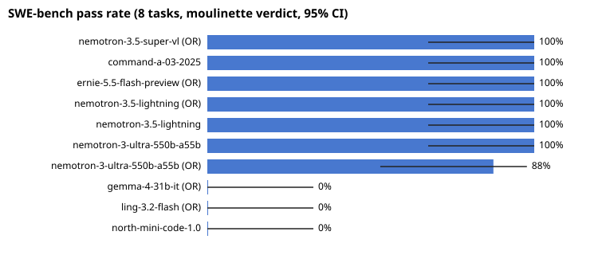
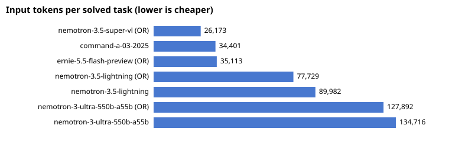
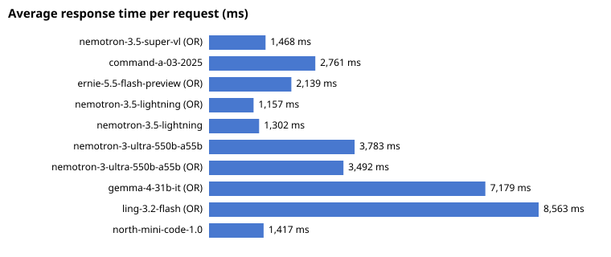
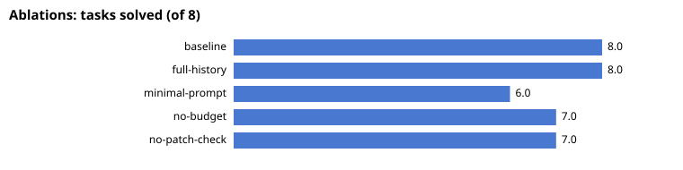

# Benchmark report

Every number below is computed by `scripts/benchmark_report.py` from the `solution.json` files under
`benchmarks/swebench/v2*/` and from the moulinette verdict next to each one (`validation.txt`, output of
`moulinette_eval validate`). The tables and charts are generated; the text around them is written from them.
All runs: 2026-11-21 / 2026-11-22, free tiers only (no card, no purchased credits).

**Summary.**
- **SWE-bench default: NVIDIA `nemotron-3.5-lightning-30b-a3b`.** It solved **24 of 24** runs (8 tasks × 3 identical
  runs), had no retries, and hit no daily cap. Its weak point is cost: 2–3× the tokens of the most economical
  models.
- **Three models solved 8/8 in one pass** with a third of the tokens: `nemotron-3.5-super-vl:free` (26k input
  tokens per task, 29 s median), Cohere `command-a` (34k) and `ernie-5.5-flash-preview:free` (35k). Each of them
  sits behind a small quota: OpenRouter `:free` allows 50 requests/day without credits, and the Cohere trial
  allows 1,000 calls/month. `super-vl` is therefore the second default.
- **Three models scored 0/8 because of their provider, not their code.** `gemma-4-31b-it:free` and
  `ling-3.2-flash:free` got 429s from the shared upstream pool, and `north-mini-code` got 422 "no valid response".
- **Ablations** (one mechanism switched off, reference model):
  - The method section of the prompt is what keeps output tokens low. Without it, output tokens went ×3 and two
    tasks were lost to the output budget.
  - Compressing old observations saves 30 % of input tokens at no cost in success.
- **MBPP default: Groq `openai/gpt-oss-120b`.** It solved 26/29 with no rate-limit retry. That ties the best
  models, but those carry a monthly quota (Cohere) or many retries (Groq `qwen`).

## 1. Setup

### Tasks

8 SWE-bench Verified tasks:
- the 3 starters the subject suggests: `sympy__sympy-14711`, `sympy__sympy-13480`, `pydata__xarray-4629`;
- 5 more from the same public dataset: `django__django-11066`, `django__django-11099`, `django__django-13658`,
  `sympy__sympy-18189`, `scikit-learn__scikit-learn-13439`.

They cover 4 repositories and 3 test runners (sympy `bin/test`, pytest, django `runtests.py`). The issues differ in
shape:
- typos and wrong names: 13480, 11066;
- a regex anchor: 11099;
- a wrong argument passed down: 13658;
- missing operator handling: 14711;
- order-dependent results: 18189;
- a missing `__len__`: 13439;
- mutable aliasing: 4629.

The task files come from `moulinette_eval dump swebench --task-id …`. The agent never reads the moulinette's exam
pool.

### Models

10 models, chosen to cover every free provider we hold a key for, with each provider's strongest and fastest free
coding model:

| Model | Provider | Why it is in the benchmark |
|---|---|---|
| `nvidia/nemotron-3.5-lightning-30b-a3b` | NVIDIA build.nvidia.com | previous winner (round 1, 3/3); no daily cap |
| `nvidia/nemotron-3-ultra-550b-a55b` | NVIDIA build.nvidia.com | largest free model; previous backup |
| `nvidia/nemotron-3.5-lightning:free` | OpenRouter | same model as above through another provider |
| `nvidia/nemotron-3-ultra-550b-a55b:free` | OpenRouter | same model as above through another provider |
| `nvidia/nemotron-3.5-super-vl:free` | OpenRouter | mid-size Nemotron, untested so far |
| `baidu/ernie-5.5-flash-preview:free` | OpenRouter | strong free model from another family |
| `google/gemma-4-31b-it:free` | OpenRouter | open-weights model of a third family |
| `inclusionai/ling-3.2-flash:free` | OpenRouter | open-weights MoE of a fourth family |
| `command-a-03-2025` | Cohere (trial key) | Cohere's agentic model; 26/29 on MBPP |
| `north-mini-code-1.0` | Cohere (trial key) | Cohere's code model |

Not on SWE-bench:
- Groq: the free tier allows 8,000 tokens/minute, and one SWE-bench prompt is 5–15k tokens.
- Gemini: the key in use returns 403. In round 1, its free quota of ~20 requests/day per model was less than one
  task.

### Agent

The agent code is commit `28e2ce4`. Commits up to `39be7e1` change only MBPP defaults and per-model request options
for Groq, none of the models above. The agent runs with:
- `SWE_SETTINGS` (`src/agent_swebench/__main__.py`) and the default `SandboxConfig`;
- temperature 0 and reasoning disabled (`extra_body` in `config/models.json`);
- **no fallback model** (`AGENT_FALLBACK=0`): every number belongs to the model named in the table.

### Limits and verdict

Limits are the exam limits:
- 30 iterations;
- 300k input / 10k output tokens;
- 900 s per task.

Every run respected them. The **grade is the moulinette verdict**, not the agent's own `success` flag (see the note
under table 2).

### Hardware and execution

- **Machine:** Apple M1 Pro, 16 GB, Docker Desktop 29.8 (4 GB, 8 CPUs). The SWE-bench images are x86_64, so they run
  under emulation and the times include emulation.
- **Streams:** three run in parallel, one per provider family (NVIDIA / OpenRouter / Cohere and ablations), so no
  provider serves two of our runs at once.
- **Validation:** each run is validated right after it ends. Overlapping validations caused one bad verdict, see
  below; they are now serialized.
- **Suite:** `scripts/run_benchmark_suite.sh` (three streams calling `scripts/run_benchmark.sh`).

### Integrity of the data

Runs were removed and re-run when the cause was the machine, not the model:

| Cause | Runs affected | Action |
|---|---|---|
| Laptop went to sleep during the run (macOS `pmset` log): the sleep counts against the 900 s and drops connections | 32 | removed, re-run |
| Working copy switched to another branch during the suite (runs started on other code) | 36 | removed, re-run from a separate worktree |
| Local DNS outage (`nodename nor servname provided`) for the whole run | 3 | re-run |
| Two moulinette validations at the same time: the moulinette writes every patch to the fixed paths `/tmp/patch.diff` and `/tmp/patch.tar`, so one validation lost its patch (`No such file or directory: '/tmp/patch.tar'`) | 1 | re-validated alone; validations are now serialized by a lock in `run_benchmark.sh` |

Checks run on the final data:
- No run overlaps a sleep period.
- Each of the 103 runs that submitted a patch was checked against the `git status` printed by the eval script. The
  files it modified in the container are exactly the files of that run's own patch.
- Provider failures that were not local (429 from a shared pool, 422 from the API) are kept. They are reliability
  data.

## 2. Results (10 models × 8 tasks, 80 runs)

| Model | Provider | Task | Moulinette | Agent `success` | Submitted by | Iterations | Input tokens | Output tokens | Time (s) |
|---|---|---|---|---|---|---|---|---|---|
| nemotron-3.5-super-vl (OR) | openrouter.ai | django__django-11066 | PASS | True | final_answer | 5 | 19,507 | 397 | 23 |
| nemotron-3.5-super-vl (OR) | openrouter.ai | django__django-11099 | PASS | True | final_answer | 6 | 14,317 | 619 | 30 |
| nemotron-3.5-super-vl (OR) | openrouter.ai | django__django-13658 | PASS | True | final_answer | 7 | 25,766 | 564 | 88 |
| nemotron-3.5-super-vl (OR) | openrouter.ai | pydata__xarray-4629 | PASS | True | final_answer | 8 | 30,053 | 908 | 28 |
| nemotron-3.5-super-vl (OR) | openrouter.ai | scikit-learn__scikit-learn-13439 | PASS | True | final_answer | 10 | 41,934 | 797 | 24 |
| nemotron-3.5-super-vl (OR) | openrouter.ai | sympy__sympy-13480 | PASS | True | final_answer | 5 | 11,746 | 387 | 25 |
| nemotron-3.5-super-vl (OR) | openrouter.ai | sympy__sympy-14711 | PASS | True | final_answer | 10 | 39,254 | 1,168 | 32 |
| nemotron-3.5-super-vl (OR) | openrouter.ai | sympy__sympy-18189 | PASS | True | final_answer | 8 | 26,808 | 636 | 53 |
| command-a-03-2025 | api.cohere.ai | django__django-11066 | PASS | True | final_answer | 4 | 19,078 | 748 | 45 |
| command-a-03-2025 | api.cohere.ai | django__django-11099 | PASS | True | final_answer | 6 | 16,455 | 746 | 39 |
| command-a-03-2025 | api.cohere.ai | django__django-13658 | PASS | True | final_answer | 7 | 31,320 | 636 | 91 |
| command-a-03-2025 | api.cohere.ai | pydata__xarray-4629 | PASS | True | final_answer | 11 | 74,367 | 1,730 | 80 |
| command-a-03-2025 | api.cohere.ai | scikit-learn__scikit-learn-13439 | PASS | True | final_answer | 5 | 19,522 | 556 | 24 |
| command-a-03-2025 | api.cohere.ai | sympy__sympy-13480 | PASS | True | final_answer | 3 | 7,042 | 294 | 42 |
| command-a-03-2025 | api.cohere.ai | sympy__sympy-14711 | PASS | True | final_answer | 13 | 80,333 | 2,384 | 111 |
| command-a-03-2025 | api.cohere.ai | sympy__sympy-18189 | PASS | True | final_answer | 6 | 27,092 | 623 | 46 |
| ernie-5.5-flash-preview (OR) | openrouter.ai | django__django-11066 | PASS | True | final_answer | 5 | 16,314 | 373 | 67 |
| ernie-5.5-flash-preview (OR) | openrouter.ai | django__django-11099 | PASS | True | final_answer | 8 | 27,944 | 2,147 | 119 |
| ernie-5.5-flash-preview (OR) | openrouter.ai | django__django-13658 | PASS | True | final_answer | 8 | 32,754 | 589 | 97 |
| ernie-5.5-flash-preview (OR) | openrouter.ai | pydata__xarray-4629 | PASS | True | final_answer | 6 | 23,653 | 407 | 44 |
| ernie-5.5-flash-preview (OR) | openrouter.ai | scikit-learn__scikit-learn-13439 | PASS | True | final_answer | 8 | 28,017 | 723 | 71 |
| ernie-5.5-flash-preview (OR) | openrouter.ai | sympy__sympy-13480 | PASS | True | final_answer | 5 | 12,619 | 387 | 87 |
| ernie-5.5-flash-preview (OR) | openrouter.ai | sympy__sympy-14711 | PASS | True | final_answer | 18 | 126,998 | 6,059 | 271 |
| ernie-5.5-flash-preview (OR) | openrouter.ai | sympy__sympy-18189 | PASS | True | final_answer | 4 | 12,605 | 427 | 85 |
| nemotron-3.5-lightning (OR) | openrouter.ai | django__django-11066 | PASS | True | final_answer | 6 | 20,060 | 406 | 22 |
| nemotron-3.5-lightning (OR) | openrouter.ai | django__django-11099 | PASS | True | final_answer | 15 | 64,606 | 3,365 | 56 |
| nemotron-3.5-lightning (OR) | openrouter.ai | django__django-13658 | PASS | True | final_answer | 15 | 76,831 | 1,208 | 95 |
| nemotron-3.5-lightning (OR) | openrouter.ai | pydata__xarray-4629 | PASS | True | final_answer | 10 | 39,263 | 1,646 | 34 |
| nemotron-3.5-lightning (OR) | openrouter.ai | scikit-learn__scikit-learn-13439 | PASS | True | final_answer | 27 | 162,517 | 1,832 | 41 |
| nemotron-3.5-lightning (OR) | openrouter.ai | sympy__sympy-13480 | PASS | True | final_answer | 5 | 22,439 | 5,057 | 35 |
| nemotron-3.5-lightning (OR) | openrouter.ai | sympy__sympy-14711 | PASS | False | fallback | 30 | 209,500 | 2,817 | 100 |
| nemotron-3.5-lightning (OR) | openrouter.ai | sympy__sympy-18189 | PASS | True | final_answer | 8 | 26,619 | 667 | 46 |
| nemotron-3.5-lightning | integrate.api.nvidia.com | django__django-11066 | PASS | True | final_answer | 7 | 25,519 | 453 | 21 |
| nemotron-3.5-lightning | integrate.api.nvidia.com | django__django-11099 | PASS | True | final_answer | 21 | 125,652 | 4,261 | 62 |
| nemotron-3.5-lightning | integrate.api.nvidia.com | django__django-13658 | PASS | True | final_answer | 25 | 135,588 | 1,439 | 99 |
| nemotron-3.5-lightning | integrate.api.nvidia.com | pydata__xarray-4629 | PASS | True | final_answer | 12 | 49,807 | 1,023 | 26 |
| nemotron-3.5-lightning | integrate.api.nvidia.com | scikit-learn__scikit-learn-13439 | PASS | False | fallback | 30 | 173,602 | 2,033 | 54 |
| nemotron-3.5-lightning | integrate.api.nvidia.com | sympy__sympy-13480 | PASS | True | final_answer | 6 | 14,133 | 482 | 63 |
| nemotron-3.5-lightning | integrate.api.nvidia.com | sympy__sympy-14711 | PASS | True | final_answer | 23 | 147,313 | 3,604 | 65 |
| nemotron-3.5-lightning | integrate.api.nvidia.com | sympy__sympy-18189 | PASS | True | final_answer | 13 | 48,242 | 1,090 | 147 |
| nemotron-3-ultra-550b-a55b | integrate.api.nvidia.com | django__django-11066 | PASS | True | final_answer | 20 | 116,088 | 1,402 | 71 |
| nemotron-3-ultra-550b-a55b | integrate.api.nvidia.com | django__django-11099 | PASS | True | final_answer | 23 | 128,743 | 4,910 | 163 |
| nemotron-3-ultra-550b-a55b | integrate.api.nvidia.com | django__django-13658 | PASS | False | fallback | 30 | 195,456 | 2,696 | 516 |
| nemotron-3-ultra-550b-a55b | integrate.api.nvidia.com | pydata__xarray-4629 | PASS | True | final_answer | 18 | 110,219 | 2,287 | 92 |
| nemotron-3-ultra-550b-a55b | integrate.api.nvidia.com | scikit-learn__scikit-learn-13439 | PASS | False | fallback | 30 | 209,894 | 3,236 | 135 |
| nemotron-3-ultra-550b-a55b | integrate.api.nvidia.com | sympy__sympy-13480 | PASS | True | final_answer | 13 | 46,266 | 1,290 | 50 |
| nemotron-3-ultra-550b-a55b | integrate.api.nvidia.com | sympy__sympy-14711 | PASS | False | fallback | 30 | 214,249 | 3,711 | 115 |
| nemotron-3-ultra-550b-a55b | integrate.api.nvidia.com | sympy__sympy-18189 | PASS | True | final_answer | 12 | 56,813 | 1,541 | 74 |
| nemotron-3-ultra-550b-a55b (OR) | openrouter.ai | django__django-11066 | PASS | True | final_answer | 18 | 107,240 | 1,510 | 77 |
| nemotron-3-ultra-550b-a55b (OR) | openrouter.ai | django__django-11099 | PASS | True | final_answer | 16 | 57,532 | 1,698 | 86 |
| nemotron-3-ultra-550b-a55b (OR) | openrouter.ai | django__django-13658 | PASS | False | fallback | 30 | 212,655 | 3,507 | 275 |
| nemotron-3-ultra-550b-a55b (OR) | openrouter.ai | pydata__xarray-4629 | PASS | True | final_answer | 17 | 98,363 | 2,550 | 132 |
| nemotron-3-ultra-550b-a55b (OR) | openrouter.ai | scikit-learn__scikit-learn-13439 | PASS | True | final_answer | 23 | 146,121 | 2,233 | 101 |
| nemotron-3-ultra-550b-a55b (OR) | openrouter.ai | sympy__sympy-13480 | PASS | True | final_answer | 11 | 38,064 | 1,160 | 57 |
| nemotron-3-ultra-550b-a55b (OR) | openrouter.ai | sympy__sympy-14711 | FAIL | False | fallback | 30 | 204,265 | 3,419 | 129 |
| nemotron-3-ultra-550b-a55b (OR) | openrouter.ai | sympy__sympy-18189 | PASS | True | final_answer | 8 | 31,002 | 1,052 | 70 |
| gemma-4-31b-it (OR) | openrouter.ai | django__django-11066 | FAIL | False | llm-failure | 1 | 2,402 | 205 | 146 |
| gemma-4-31b-it (OR) | openrouter.ai | django__django-11099 | FAIL | False | llm-failure | 0 | 0 | 0 | 138 |
| gemma-4-31b-it (OR) | openrouter.ai | django__django-13658 | FAIL | False | llm-failure | 0 | 0 | 0 | 139 |
| gemma-4-31b-it (OR) | openrouter.ai | pydata__xarray-4629 | FAIL | False | llm-failure | 0 | 0 | 0 | 137 |
| gemma-4-31b-it (OR) | openrouter.ai | scikit-learn__scikit-learn-13439 | FAIL | False | llm-failure | 0 | 0 | 0 | 136 |
| gemma-4-31b-it (OR) | openrouter.ai | sympy__sympy-13480 | FAIL | False | llm-failure | 0 | 0 | 0 | 138 |
| gemma-4-31b-it (OR) | openrouter.ai | sympy__sympy-14711 | FAIL | False | llm-failure | 0 | 0 | 0 | 138 |
| gemma-4-31b-it (OR) | openrouter.ai | sympy__sympy-18189 | FAIL | False | llm-failure | 0 | 0 | 0 | 137 |
| ling-3.2-flash (OR) | openrouter.ai | django__django-11066 | FAIL | False | llm-failure | 0 | 0 | 0 | 139 |
| ling-3.2-flash (OR) | openrouter.ai | django__django-11099 | FAIL | False | llm-failure | 0 | 0 | 0 | 140 |
| ling-3.2-flash (OR) | openrouter.ai | django__django-13658 | FAIL | False | llm-failure | 1 | 1,696 | 52 | 200 |
| ling-3.2-flash (OR) | openrouter.ai | pydata__xarray-4629 | FAIL | False | llm-failure | 4 | 12,144 | 497 | 293 |
| ling-3.2-flash (OR) | openrouter.ai | scikit-learn__scikit-learn-13439 | FAIL | False | llm-failure | 0 | 0 | 0 | 140 |
| ling-3.2-flash (OR) | openrouter.ai | sympy__sympy-13480 | FAIL | False | llm-failure | 0 | 0 | 0 | 139 |
| ling-3.2-flash (OR) | openrouter.ai | sympy__sympy-14711 | FAIL | False | llm-failure | 1 | 1,653 | 71 | 267 |
| ling-3.2-flash (OR) | openrouter.ai | sympy__sympy-18189 | FAIL | False | llm-failure | 1 | 2,403 | 143 | 156 |
| north-mini-code-1.0 | api.cohere.ai | django__django-11066 | FAIL | False | llm-failure | 0 | 0 | 0 | 2 |
| north-mini-code-1.0 | api.cohere.ai | django__django-11099 | FAIL | False | llm-failure | 0 | 0 | 0 | 5 |
| north-mini-code-1.0 | api.cohere.ai | django__django-13658 | FAIL | False | llm-failure | 0 | 0 | 0 | 2 |
| north-mini-code-1.0 | api.cohere.ai | pydata__xarray-4629 | FAIL | False | llm-failure | 0 | 0 | 0 | 2 |
| north-mini-code-1.0 | api.cohere.ai | scikit-learn__scikit-learn-13439 | FAIL | False | llm-failure | 0 | 0 | 0 | 2 |
| north-mini-code-1.0 | api.cohere.ai | sympy__sympy-13480 | FAIL | False | llm-failure | 0 | 0 | 0 | 2 |
| north-mini-code-1.0 | api.cohere.ai | sympy__sympy-14711 | FAIL | False | none | 18 | 102,349 | 9,999 | 32 |
| north-mini-code-1.0 | api.cohere.ai | sympy__sympy-18189 | FAIL | False | llm-failure | 0 | 0 | 0 | 2 |

*Moulinette* = `Overall` of `moulinette_eval validate` (the grade). *Agent `success`* = the agent called `final_answer` with a patch; when it ran out of iterations or the provider stopped answering, the best patch so far is still submitted (*Submitted by: fallback*), so a run can be `success: false` and still PASS, or `success: true` and FAIL (a wrong fix).


**Per model** (pass rate with a 95 % Wilson interval: with 8 tasks one run more or less moves it a lot)

| Model | Provider | Solved | 95 % CI | Avg iterations | Avg input tok | Avg output tok | Median time (s) | Input tok per solved task | Paid-equivalent $ per solved task |
|---|---|---|---|---|---|---|---|---|---|
| nemotron-3.5-super-vl (OR) | openrouter.ai | **8/8** | 68%–100% | 7.4 | 26,173 | 684 | 29 | 26,173 | $0.0042 |
| command-a-03-2025 | api.cohere.ai | **8/8** | 68%–100% | 6.9 | 34,401 | 965 | 46 | 34,401 | $0.0956 |
| ernie-5.5-flash-preview (OR) | openrouter.ai | **8/8** | 68%–100% | 7.8 | 35,113 | 1,389 | 86 | 35,113 | n/a |
| nemotron-3.5-lightning (OR) | openrouter.ai | **8/8** | 68%–100% | 14.5 | 77,729 | 2,125 | 44 | 77,729 | $0.0059 |
| nemotron-3.5-lightning | integrate.api.nvidia.com | **8/8** | 68%–100% | 17.1 | 89,982 | 1,798 | 63 | 89,982 | $0.0067 |
| nemotron-3-ultra-550b-a55b | integrate.api.nvidia.com | **8/8** | 68%–100% | 22.0 | 134,716 | 2,634 | 103 | 134,716 | $0.0732 |
| nemotron-3-ultra-550b-a55b (OR) | openrouter.ai | **7/8** | 53%–98% | 19.1 | 111,905 | 2,141 | 93 | 127,892 | $0.0693 |
| gemma-4-31b-it (OR) | openrouter.ai | **0/8** | 0%–32% | 0.1 | 300 | 26 | 138 | – | n/a |
| ling-3.2-flash (OR) | openrouter.ai | **0/8** | 0%–32% | 0.9 | 2,237 | 95 | 148 | – | n/a |
| north-mini-code-1.0 | api.cohere.ai | **0/8** | 0%–32% | 2.2 | 12,794 | 1,250 | 2 | – | n/a |






**Per task** (how hard each task is across all models)

| Task | Models that solve it | Avg iterations | Avg input tokens |
|---|---|---|---|
| django__django-11066 | 7/10 | 6.6 | 32,621 |
| django__django-11099 | 7/10 | 9.5 | 43,525 |
| django__django-13658 | 7/10 | 12.3 | 71,207 |
| pydata__xarray-4629 | 7/10 | 8.6 | 43,787 |
| scikit-learn__scikit-learn-13439 | 7/10 | 13.3 | 78,161 |
| sympy__sympy-13480 | 7/10 | 4.8 | 15,231 |
| sympy__sympy-14711 | 6/10 | 17.3 | 112,591 |
| sympy__sympy-18189 | 7/10 | 6.0 | 23,158 |

## 3. Provider reliability

| Model | Provider | Requests | Avg response (ms) | p95 response (ms) | Retries | Retries per request | Runs cut by the provider | Availability |
|---|---|---|---|---|---|---|---|---|
| nemotron-3.5-super-vl (OR) | openrouter.ai | 59 | 1,468 | 3,349 | 0 | 0.00 | 0/8 | 100% |
| command-a-03-2025 | api.cohere.ai | 56 | 2,761 | 4,901 | 1 | 0.02 | 0/8 | 100% |
| ernie-5.5-flash-preview (OR) | openrouter.ai | 84 | 2,139 | 3,794 | 22 | 0.26 | 0/8 | 100% |
| nemotron-3.5-lightning (OR) | openrouter.ai | 117 | 1,157 | 4,126 | 1 | 0.01 | 0/8 | 100% |
| nemotron-3.5-lightning | integrate.api.nvidia.com | 137 | 1,302 | 3,487 | 0 | 0.00 | 0/8 | 100% |
| nemotron-3-ultra-550b-a55b | integrate.api.nvidia.com | 176 | 3,783 | 8,968 | 0 | 0.00 | 0/8 | 100% |
| nemotron-3-ultra-550b-a55b (OR) | openrouter.ai | 153 | 3,492 | 7,047 | 0 | 0.00 | 0/8 | 100% |
| gemma-4-31b-it (OR) | openrouter.ai | 49 | 7,179 | 7,179 | 0 | 0.00 | 8/8 | 0% |
| ling-3.2-flash (OR) | openrouter.ai | 69 | 8,563 | 17,982 | 14 | 0.20 | 8/8 | 0% |
| north-mini-code-1.0 | api.cohere.ai | 25 | 1,417 | 2,984 | 0 | 0.00 | 7/8 | 12% |




## 4. Intermediary metrics

| Model | Task | Moulinette | First read of a patched file | First edit of it | Failures first decrease | Tests first pass | Steps from first pass to final_answer |
|---|---|---|---|---|---|---|---|
| nemotron-3.5-super-vl (OR) | django__django-11066 | PASS | 1 | 2 | – | 4 | 1 |
| nemotron-3.5-super-vl (OR) | django__django-11099 | PASS | 2 | 3 | – | 5 | 1 |
| nemotron-3.5-super-vl (OR) | django__django-13658 | PASS | 1 | 4 | – | 5 | 2 |
| nemotron-3.5-super-vl (OR) | pydata__xarray-4629 | PASS | 2 | 4 | – | 7 | 1 |
| nemotron-3.5-super-vl (OR) | scikit-learn__scikit-learn-13439 | PASS | 3 | 6 | – | 8 | 2 |
| nemotron-3.5-super-vl (OR) | sympy__sympy-13480 | PASS | 1 | 2 | – | 4 | 1 |
| nemotron-3.5-super-vl (OR) | sympy__sympy-14711 | PASS | 2 | 6 | – | 8 | 2 |
| nemotron-3.5-super-vl (OR) | sympy__sympy-18189 | PASS | 3 | 4 | – | 6 | 2 |
| command-a-03-2025 | django__django-11066 | PASS | 1 | 2 | – | 2 | 2 |
| command-a-03-2025 | django__django-11099 | PASS | 3 | 4 | – | 4 | 2 |
| command-a-03-2025 | django__django-13658 | PASS | 2 | 5 | – | 6 | 1 |
| command-a-03-2025 | pydata__xarray-4629 | PASS | 1 | 3 | – | 5 | 6 |
| command-a-03-2025 | scikit-learn__scikit-learn-13439 | PASS | 2 | 3 | – | 4 | 1 |
| command-a-03-2025 | sympy__sympy-13480 | PASS | 1 | 2 | – | 2 | 1 |
| command-a-03-2025 | sympy__sympy-14711 | PASS | 2 | 4 | 12 | 12 | 1 |
| command-a-03-2025 | sympy__sympy-18189 | PASS | 2 | 4 | – | 5 | 1 |
| ernie-5.5-flash-preview (OR) | django__django-11066 | PASS | 1 | 2 | – | 3 | 2 |
| ernie-5.5-flash-preview (OR) | django__django-11099 | PASS | 1 | 3 | – | 6 | 2 |
| ernie-5.5-flash-preview (OR) | django__django-13658 | PASS | 1 | 5 | – | 6 | 2 |
| ernie-5.5-flash-preview (OR) | pydata__xarray-4629 | PASS | 1 | 4 | – | 4 | 2 |
| ernie-5.5-flash-preview (OR) | scikit-learn__scikit-learn-13439 | PASS | 3 | 6 | – | 7 | 1 |
| ernie-5.5-flash-preview (OR) | sympy__sympy-13480 | PASS | 1 | 3 | – | 3 | 2 |
| ernie-5.5-flash-preview (OR) | sympy__sympy-14711 | PASS | 1 | 11 | – | 14 | 4 |
| ernie-5.5-flash-preview (OR) | sympy__sympy-18189 | PASS | 1 | 2 | – | 2 | 2 |
| nemotron-3.5-lightning (OR) | django__django-11066 | PASS | 2 | 3 | – | 4 | 2 |
| nemotron-3.5-lightning (OR) | django__django-11099 | PASS | 2 | 4 | – | 14 | 1 |
| nemotron-3.5-lightning (OR) | django__django-13658 | PASS | 9 | 12 | – | 12 | 3 |
| nemotron-3.5-lightning (OR) | pydata__xarray-4629 | PASS | 4 | 5 | – | – | – |
| nemotron-3.5-lightning (OR) | scikit-learn__scikit-learn-13439 | PASS | 3 | 19 | – | 24 | 3 |
| nemotron-3.5-lightning (OR) | sympy__sympy-13480 | PASS | 1 | 3 | – | 3 | 2 |
| nemotron-3.5-lightning (OR) | sympy__sympy-14711 | PASS | 2 | 19 | – | 24 | – |
| nemotron-3.5-lightning (OR) | sympy__sympy-18189 | PASS | 2 | 3 | – | 7 | 1 |
| nemotron-3.5-lightning | django__django-11066 | PASS | 3 | 4 | – | 5 | 2 |
| nemotron-3.5-lightning | django__django-11099 | PASS | 2 | 3 | – | 19 | 2 |
| nemotron-3.5-lightning | django__django-13658 | PASS | 14 | 20 | – | 21 | 4 |
| nemotron-3.5-lightning | pydata__xarray-4629 | PASS | 4 | 8 | – | 10 | 2 |
| nemotron-3.5-lightning | scikit-learn__scikit-learn-13439 | PASS | 3 | 12 | – | – | – |
| nemotron-3.5-lightning | sympy__sympy-13480 | PASS | 3 | 4 | – | 4 | 2 |
| nemotron-3.5-lightning | sympy__sympy-14711 | PASS | 2 | 16 | – | 20 | 3 |
| nemotron-3.5-lightning | sympy__sympy-18189 | PASS | 2 | 3 | – | – | – |
| nemotron-3-ultra-550b-a55b | django__django-11066 | PASS | 2 | 3 | – | 6 | 14 |
| nemotron-3-ultra-550b-a55b | django__django-11099 | PASS | 2 | 5 | – | 10 | 13 |
| nemotron-3-ultra-550b-a55b | django__django-13658 | PASS | 2 | 8 | – | 12 | – |
| nemotron-3-ultra-550b-a55b | pydata__xarray-4629 | PASS | 1 | 6 | – | 8 | 10 |
| nemotron-3-ultra-550b-a55b | scikit-learn__scikit-learn-13439 | PASS | 3 | 7 | – | – | – |
| nemotron-3-ultra-550b-a55b | sympy__sympy-13480 | PASS | 1 | 2 | – | 11 | 2 |
| nemotron-3-ultra-550b-a55b | sympy__sympy-14711 | PASS | 2 | 19 | – | – | – |
| nemotron-3-ultra-550b-a55b | sympy__sympy-18189 | PASS | 3 | 6 | – | 10 | 2 |
| nemotron-3-ultra-550b-a55b (OR) | django__django-11066 | PASS | 1 | 2 | – | 5 | 13 |
| nemotron-3-ultra-550b-a55b (OR) | django__django-11099 | PASS | 2 | 5 | – | 12 | 4 |
| nemotron-3-ultra-550b-a55b (OR) | django__django-13658 | PASS | 2 | 7 | – | 11 | – |
| nemotron-3-ultra-550b-a55b (OR) | pydata__xarray-4629 | PASS | 1 | 5 | – | 8 | 9 |
| nemotron-3-ultra-550b-a55b (OR) | scikit-learn__scikit-learn-13439 | PASS | 3 | 9 | – | 14 | 9 |
| nemotron-3-ultra-550b-a55b (OR) | sympy__sympy-13480 | PASS | 1 | 2 | – | 8 | 3 |
| nemotron-3-ultra-550b-a55b (OR) | sympy__sympy-14711 | FAIL | 2 | 14 | – | – | – |
| nemotron-3-ultra-550b-a55b (OR) | sympy__sympy-18189 | PASS | 2 | 4 | – | 6 | 2 |
| gemma-4-31b-it (OR) | django__django-11066 | FAIL | – | – | – | – | – |
| gemma-4-31b-it (OR) | django__django-11099 | FAIL | – | – | – | – | – |
| gemma-4-31b-it (OR) | django__django-13658 | FAIL | – | – | – | – | – |
| gemma-4-31b-it (OR) | pydata__xarray-4629 | FAIL | – | – | – | – | – |
| gemma-4-31b-it (OR) | scikit-learn__scikit-learn-13439 | FAIL | – | – | – | – | – |
| gemma-4-31b-it (OR) | sympy__sympy-13480 | FAIL | – | – | – | – | – |
| gemma-4-31b-it (OR) | sympy__sympy-14711 | FAIL | – | – | – | – | – |
| gemma-4-31b-it (OR) | sympy__sympy-18189 | FAIL | – | – | – | – | – |
| ling-3.2-flash (OR) | django__django-11066 | FAIL | – | – | – | – | – |
| ling-3.2-flash (OR) | django__django-11099 | FAIL | – | – | – | – | – |
| ling-3.2-flash (OR) | django__django-13658 | FAIL | – | – | – | – | – |
| ling-3.2-flash (OR) | pydata__xarray-4629 | FAIL | – | – | – | – | – |
| ling-3.2-flash (OR) | scikit-learn__scikit-learn-13439 | FAIL | – | – | – | – | – |
| ling-3.2-flash (OR) | sympy__sympy-13480 | FAIL | – | – | – | – | – |
| ling-3.2-flash (OR) | sympy__sympy-14711 | FAIL | – | – | – | – | – |
| ling-3.2-flash (OR) | sympy__sympy-18189 | FAIL | – | – | – | – | – |
| north-mini-code-1.0 | django__django-11066 | FAIL | – | – | – | – | – |
| north-mini-code-1.0 | django__django-11099 | FAIL | – | – | – | – | – |
| north-mini-code-1.0 | django__django-13658 | FAIL | – | – | – | – | – |
| north-mini-code-1.0 | pydata__xarray-4629 | FAIL | – | – | – | – | – |
| north-mini-code-1.0 | scikit-learn__scikit-learn-13439 | FAIL | – | – | – | – | – |
| north-mini-code-1.0 | sympy__sympy-13480 | FAIL | – | – | – | – | – |
| north-mini-code-1.0 | sympy__sympy-14711 | FAIL | – | – | – | – | – |
| north-mini-code-1.0 | sympy__sympy-18189 | FAIL | – | – | – | – | – |

**Averages per model** (in brackets: number of runs where the event happened)

| Model | First read | First edit | Tests first pass | Pass → final_answer gap | Runs submitted by fallback |
|---|---|---|---|---|---|
| nemotron-3.5-super-vl (OR) | 1.9 (8) | 3.9 (8) | 5.9 (8) | 1.5 (8) | 0/8 |
| command-a-03-2025 | 1.8 (8) | 3.4 (8) | 5.0 (8) | 1.9 (8) | 0/8 |
| ernie-5.5-flash-preview (OR) | 1.2 (8) | 4.5 (8) | 5.6 (8) | 2.1 (8) | 0/8 |
| nemotron-3.5-lightning (OR) | 3.1 (8) | 8.5 (8) | 12.6 (7) | 2.0 (6) | 1/8 |
| nemotron-3.5-lightning | 4.1 (8) | 8.8 (8) | 13.2 (6) | 2.5 (6) | 1/8 |
| nemotron-3-ultra-550b-a55b | 2.0 (8) | 7.0 (8) | 9.5 (6) | 8.2 (5) | 3/8 |
| nemotron-3-ultra-550b-a55b (OR) | 1.8 (8) | 6.0 (8) | 9.1 (7) | 6.7 (6) | 2/8 |
| gemma-4-31b-it (OR) | – | – | – | – | 0/8 |
| ling-3.2-flash (OR) | – | – | – | – | 0/8 |
| north-mini-code-1.0 | – | – | – | – | 0/8 |

## 5. Run-to-run variance (nemotron-3.5-lightning, 3 identical runs of the 8 tasks)

| Task | Passed (runs) | Iterations per run | Input tokens per run |
|---|---|---|---|
| django__django-11066 | 3/3 | 7 / 6 / 6 | 25k / 21k / 20k |
| django__django-11099 | 3/3 | 21 / 29 / 11 | 125k / 216k / 41k |
| django__django-13658 | 3/3 | 25 / 13 / 10 | 135k / 50k / 38k |
| pydata__xarray-4629 | 3/3 | 12 / 9 / 12 | 49k / 36k / 52k |
| scikit-learn__scikit-learn-13439 | 3/3 | 30 / 26 / 29 | 173k / 159k / 179k |
| sympy__sympy-13480 | 3/3 | 6 / 8 / 5 | 14k / 20k / 14k |
| sympy__sympy-14711 | 3/3 | 23 / 30 / 22 | 147k / 204k / 112k |
| sympy__sympy-18189 | 3/3 | 13 / 5 / 17 | 48k / 16k / 74k |

Solved per run: 8, 8, 8 of 8 — mean 8.00, standard deviation 0.00. Mean input tokens per task per run: 89,982, 90,715, 66,566 (sd 11,215). A task is *reliably* solved when it passes in every run: 8/8.


## 6. Ablations (reference model, same tasks, one mechanism off)

| Variant | Solved | Avg iterations | Avg input tok | Avg output tok | Avg time (s) | Fallback submissions |
|---|---|---|---|---|---|---|
| baseline (mean of the identical runs) | 8.0/8 | 15.6 | 82,421 | 1,714 | 59 | 2 |
| full-history | 8/8 | 15.8 | 118,581 | 2,500 | 64 | 2 |
| minimal-prompt | 6/8 | 16.2 | 101,291 | 5,151 | 75 | 2 |
| no-budget | 7/8 | 17.0 | 81,759 | 1,833 | 51 | 1 |
| no-patch-check | 7/8 | 18.6 | 117,153 | 2,969 | 69 | 1 |




Per task:

| Task | baseline (runs passed) | full-history | minimal-prompt | no-budget | no-patch-check |
|---|---|---|---|---|---|
| django__django-11066 | 3/3 | PASS | PASS | PASS | PASS |
| django__django-11099 | 3/3 | PASS | PASS | PASS | FAIL |
| django__django-13658 | 3/3 | PASS | FAIL | PASS | PASS |
| pydata__xarray-4629 | 3/3 | PASS | PASS | PASS | PASS |
| scikit-learn__scikit-learn-13439 | 3/3 | PASS | PASS | FAIL | PASS |
| sympy__sympy-13480 | 3/3 | PASS | FAIL | PASS | PASS |
| sympy__sympy-14711 | 3/3 | PASS | PASS | PASS | PASS |
| sympy__sympy-18189 | 3/3 | PASS | PASS | PASS | PASS |

## 7. Cost analysis

Every run above was free (free tiers / `:free` models). Two costs still matter: the **free quota** a task consumes, and what the same tokens would cost on the **paid** version of the model (public OpenRouter prices of 2026-11-21, `benchmarks/swebench/paid-equivalent-prices.json`).

| Model | Requests per task | Free quota | Full SWE exams (3 tasks) per day of quota | Paid-equivalent $ per task | Paid-equivalent $ per solved task |
|---|---|---|---|---|---|
| nemotron-3.5-super-vl (OR) | 7.4 | :free models: 1,000 requests/day (account with >= $10 credits; 50/day without) | 45 | $0.0042 | $0.0042 |
| command-a-03-2025 | 7.0 | trial key: 1,000 calls/month, 20/min | 2 | $0.0956 | $0.0956 |
| ernie-5.5-flash-preview (OR) | 10.5 | :free models: 1,000 requests/day (account with >= $10 credits; 50/day without) | 32 | n/a | n/a |
| nemotron-3.5-lightning (OR) | 14.6 | :free models: 1,000 requests/day (account with >= $10 credits; 50/day without) | 23 | $0.0059 | $0.0059 |
| nemotron-3.5-lightning | 17.1 | ~40 requests/min, no daily cap observed | not limiting | $0.0067 | $0.0067 |
| nemotron-3-ultra-550b-a55b | 22.0 | ~40 requests/min, no daily cap observed | not limiting | $0.0732 | $0.0732 |
| nemotron-3-ultra-550b-a55b (OR) | 19.1 | :free models: 1,000 requests/day (account with >= $10 credits; 50/day without) | 17 | $0.0607 | $0.0693 |
| gemma-4-31b-it (OR) | 6.1 | :free models: 1,000 requests/day (account with >= $10 credits; 50/day without) | 54 | $0.0001 | n/a |
| ling-3.2-flash (OR) | 8.6 | :free models: 1,000 requests/day (account with >= $10 credits; 50/day without) | 39 | n/a | n/a |
| north-mini-code-1.0 | 3.1 | trial key: 1,000 calls/month, 20/min | 4 | n/a | n/a |

## 8. Findings and insights

### Model choice

- **Success does not separate the good models on these tasks; cost and quota do.**
  - Seven models solve 8/8 or 7/8, and their confidence intervals overlap entirely (68–100 %).
  - Input tokens per task range from 26k (`super-vl`) to 135k (`ultra` on NVIDIA). That is ×5 on the free quota,
    and ×17 on the paid-equivalent price ($0.004 vs $0.073 per task).
- **Bigger is not better here.**
  - `nemotron-3-ultra` (550B) is the most expensive model on both providers. It used 3/8 fallback submissions on
    NVIDIA and lost one task on OpenRouter.
  - It keeps working after its tests are green: on average 8 steps between the first passing `run_tests` and
    `final_answer`, against 1.5–2.5 for the small models.
  - So it spends tokens on verification it does not need.
- **The same model behaves the same through two providers.**
  - Lightning on NVIDIA: 8/8, 90k tokens per task. On OpenRouter: 8/8, 78k.
  - Ultra on NVIDIA: 8/8. On OpenRouter: 7/8.
  - So the second provider is a valid fallback for the same model.
  - The difference between providers is latency and quota, not quality:
    - NVIDIA lightning: 1.3 s per request, no retries, no daily cap;
    - OpenRouter: 1.2 s per request, but 50 requests/day without credits.

### Why `nemotron-3.5-lightning` on NVIDIA stays the default

- It is the only model with **repeated** runs: 24/24, standard deviation 0.
- It is the only free endpoint with **no daily cap and no retry** in its 137 requests of the main run. Across all
  of its runs it had 10 retries in 926 requests, and none ended a run.
- An exam needs ~50 requests (3 tasks × 17). That is the full daily quota of an OpenRouter account without credits,
  and 5 % of the Cohere trial's month.

`super-vl:free` comes second: it is the cheapest model that solved everything, but it was measured in one run only.

### Providers fail in three different ways

These are worth knowing before an exam:
1. **Shared-pool rate limits:**
   - `gemma-4:free` and `ling-3.2:free` got 429 `upstream_provider_shared_pool` from the first request.
   - It is not our quota: the free pool of the upstream provider was exhausted by other users. Retrying for
     minutes did not help.
   - Availability was 0 % in our window.
2. **Model-specific API rejection:**
   - Cohere `north-mini-code` answers 422 "No valid response generated" to our SWE-bench system prompt in 7 of 8
     runs.
   - The same model solves 23/29 MBPP tasks, so the long tool-use prompt is the trigger.
   - The one run that got answers exhausted the output budget (9,999 / 10,000) in 18 steps.
3. **Local network:** a DNS outage on our side cut 3 runs; they were re-run (see "Integrity of the data").

### Intermediary metrics

- **Locating the code is not the bottleneck.** Every model that solved a task read a file of the final patch within
  2–4 steps on average. Lightning on NVIDIA is the slowest to get there (4.1), and needs 2 steps more than
  `super-vl`/`command-a`.
- **The difference is between the first edit and green tests:**
  - 2 steps for `super-vl`/`command-a`;
  - 4–5 steps for lightning (more `run_tests` cycles to fix its own first attempt).
- **"Failures first decrease" is almost always empty.** The eval scripts run a handful of targeted tests, so a run
  goes from failing to passing in one edit. The one exception, `command-a` on 14711, drops its failures and turns
  green at the same step.
- **Fallback submissions:**
  - Lightning (NVIDIA): 1/8. Ultra: 3/8.
  - A fallback submission is the best patch so far, submitted when the iteration limit hits.
  - It passes the moulinette more often than not (6 of 7 fallbacks passed in table 2). That is why `success:
    false` and *PASS* can go together.

### Ablations: what each mechanism is worth

Each ablation is one run of 8 tasks. The baseline is the mean of 3 identical runs (24/24), so one task more or less
is within noise; the token and step counts are the stronger signal.

- **Minimal prompt** (no method / efficiency / integrity section, no example): **6/8**, output tokens ×3
  (5,151 vs 1,714 per task).
  - Without "one code block per reply, then STOP and wait", the model writes several code blocks per reply. It hits
    the 1,500-token reply cap, and two runs exhausted the 10k output budget (13658 after 7 steps with no patch;
    13480).
  - The same variant triggered the **patch check 8 times** in one run (18189: `final_answer` with prose, refused
    with a hint, then a correct patch).
  - So the prompt's method section is what keeps the agent inside the output budget.
- **Full history** (old observations not compressed): **8/8** but **+44 % input tokens** (119k vs 82k per task).
  - Compression costs no success and saves a third of the context.
  - That matters most for quota-limited providers and for long tasks: 14711 and 13439 approach the 300k budget
    without it.
- **No budget line** (iterations / tokens / time left not shown after each observation): **7/8**.
  - The lost task (13439) ended in a read loop: the same `read_file` five times until iteration 30.
  - With the budget line, the model is told how many steps remain and submits.
- **No patch check** (`final_answer` accepted even if it is not a diff): **7/8**, but the check never fired in the
  baseline runs with the full prompt either.
  - The lost task (11099) is a read loop, not a non-patch answer.
  - So with the full prompt this mechanism is a safety net that this model rarely needs. It matters with a weaker
    prompt (8 refusals above), and once with `ultra:free` (13480, refused once and then passed).

## 9. MBPP

Same method, the MBPP agent:
- 29 distinct tasks drawn by `moulinette_eval dump mbpp --seed 1..30`;
- moulinette verdict;
- limits of 10 iterations, 6k input / 1.5k output tokens, 120 s;
- data in `benchmarks/mbpp/v2/`.

| Model | Provider | Solved | Solved at step 1 | Avg iterations | Avg input tok | Median time (s) | Max time (s) | Retries |
|---|---|---|---|---|---|---|---|---|
| `openai/gpt-oss-120b` | Groq | **26/29** | 20 | 1.69 | 1,512 | 1.4 | 57 | 0 |
| `qwen/qwen3.8-27b` | Groq | **26/29** | 11 | 1.66 | 1,439 | 7.7 | 56 | 26 |
| `command-a-03-2025` | Cohere | **26/29** | 22 | 1.38 | 1,344 | 2.5 | 35 | 4 |
| `nemotron-3.5-lightning-30b-a3b` | NVIDIA | 24/29 | 11 | 2.24 | 2,168 | 2.2 | 7 | 0 |
| `north-mini-code-1.0` | Cohere | 23/29 | 17 | 1.86 | 1,785 | 1.9 | 44 | 10 |
| `nemotron-3.5-lightning:free` | OpenRouter | 22/29 | 15 | 1.90 | 1,830 | 2.7 | 9 | 0 |

- **Default: `gpt-oss-120b` on Groq.**
  - It ties for the best score.
  - It has no rate-limit retry: `qwen` needed 26 retries against Groq's per-minute token cap.
  - It is the fastest (1.4 s median), and every run stays far below the 120 s limit (57 s at worst).
  - `command-a` is as good, but its trial key allows 1,000 calls per month.
- **Remaining failures are budget, not knowledge.**
  - 21 of the 27 failures across all models are "input-token budget exhausted". With 6k input tokens, three or four
    failed attempts fill the context.
  - Task 400 fails for 5 of 6 models with a wrong answer: the code passes the two visible tests and fails the
    moulinette's hidden ones.

## 10. Reproduce

```bash
git checkout exam-ready                   # agent of this report: 28e2ce4 (unchanged for SWE-bench up to the report commit)
cp .env.example .env                      # NVIDIA_API_KEY, OPENROUTER_API_KEY, COHERE_API_KEY (free)
./scripts/run_benchmark_suite.sh          # 3 streams: models × 8 tasks, repeats, ablations (resumable)
uv run python scripts/benchmark_report.py # tables of sections 2–7 + charts in benchmarks/swebench/charts/
RUN=v2 ./scripts/run_mbpp.sh openai/gpt-oss-120b https://api.groq.com/openai/v1 $(seq 1 30)
```

Notes:
- A single pair: `TASKS=… MODELS="url|model" ./scripts/run_benchmark.sh <run-name>`.
- Ablations: `AGENT_ARGS="--ablation no-budget"` (or `full-history`, `no-patch-check`) and
  `AGENT_ARGS="--prompt-variant minimal"`.
- Keep the machine awake (`caffeinate -dimsu`) and do not switch branches in the working copy during a run. Run the
  suite from a separate `git worktree`.

## 11. Round 1 (kept for reference)

The first round (2026-11-10) is kept unchanged in `benchmarks/swebench/main/` and
`benchmarks/swebench/ablation-minimal-prompt/`:
- 5 models × the 3 starter tasks;
- Gemini and Mistral-large via NVIDIA included.

It found four agent defects, all fixed before this round:
1. The sympy result parser read the wrong stream.
2. DNS errors were retried only 6 times.
3. `final_answer` accepted a description instead of a patch: the patch check above.
4. An empty model reply was stored and refused by the API.

Its winner was the same model (lightning, 3/3).
